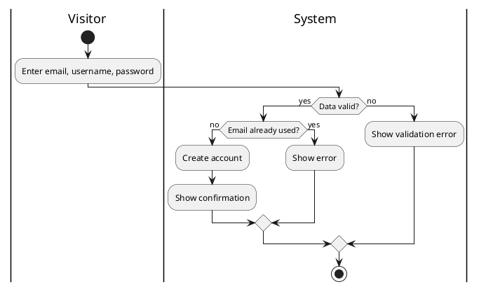
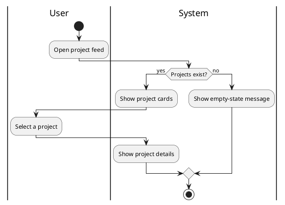
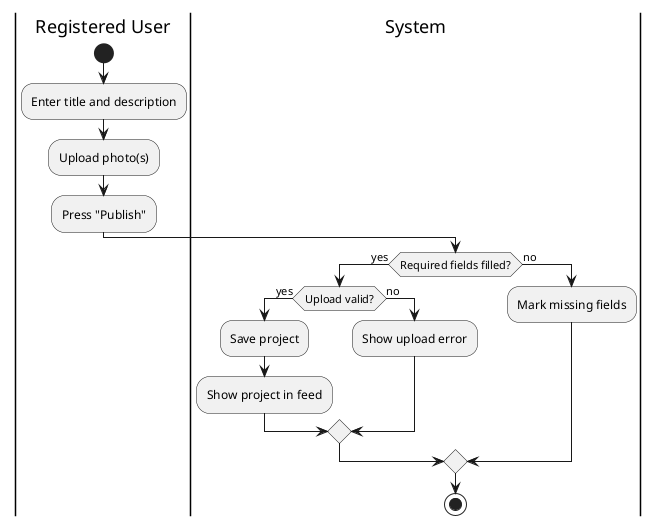
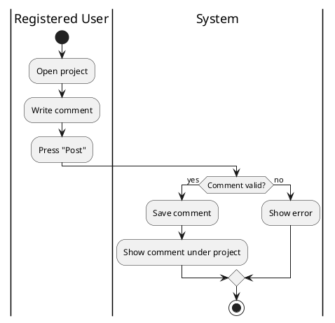
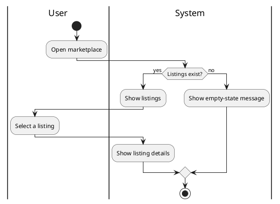

# KNIT HAPPENS: Use Case Descriptions

Template: RUP use case properties. Each use case also has a UI mockup (1), a Gherkin scenario (2) and an activity diagram (3).
Items marked *tbd* are not decided yet.

---

## UC-1: Create account

| Property | Description |
|---|---|
| **Name** | Create account |
| **Brief Description** | A visitor registers to become a Registered User, so they can share projects and comment. |
| **Flow of Events** | 1. The visitor selects "Create account".<br>2. The system asks for email, username and password.<br>3. The visitor enters the data.<br>4. The system validates the data.<br>5. The system creates the account and confirms it.<br>**Alternative A:** The email is already registered. The system shows an error and offers to log in.<br>**Alternative B:** The password is too weak. The system explains the rules and the visitor retries. |
| **Special Requirements** | Passwords are never stored in plain text. Password rules: *tbd*. |
| **Preconditions** | The user is not logged in and has no account with this email. |
| **Postconditions** | An account exists and the user can log in. |
| **Extension Points** | None |
| **Relationships** | Actor: Visitor. Package: Accounts & Authentication. |
| **Use-Case Diagram** | KNIT HAPPENS overall use case diagram |

**Mockup (1):** *Figma screen: registration form with email, username, password and a "Create account" button.*

**Scenario (2):**
```gherkin
Scenario: Create account
  Given I am a visitor without an account
  When I go to the registration page
  And I fill in the following:
    | Email    | knitter@example.com |
    | Username | woolwizard          |
    | Password | ********            |
  And I press "Create account"
  Then I should see "Account created successfully."
```

**Activity diagram (3):**


---

## UC-2: Explore projects

| Property | Description |
|---|---|
| **Name** | Explore projects |
| **Brief Description** | A user browses shared projects to find inspiration. |
| **Flow of Events** | 1. The user opens the project feed.<br>2. The system shows projects with photo, title and creator.<br>3. The user scrolls and selects a project.<br>4. The system shows the project details.<br>**Alternative A:** No projects exist yet. The system shows an empty-state message. |
| **Special Requirements** | The feed must load quickly and work on phone screens. Maximum load time: *tbd*. |
| **Preconditions** | None. A login is not required. |
| **Postconditions** | The user has viewed projects. No data is changed. |
| **Extension Points** | None |
| **Relationships** | Actor: Platform User (Visitor and Registered User). Package: Social Area. |
| **Use-Case Diagram** | KNIT HAPPENS overall use case diagram |

**Mockup (1):** *Figma screen: feed with project cards (photo, title, creator).*

**Scenario (2):**
```gherkin
Scenario: Explore projects
  Given there are shared projects
  When I go to the project feed
  And I select a project
  Then I should see the project details
```

**Activity diagram (3):**


---

## UC-3: Share project

| Property | Description |
|---|---|
| **Name** | Share project |
| **Brief Description** | A registered user publishes a finished knitting project with photos and a description. |
| **Flow of Events** | 1. The user selects "Share project".<br>2. The user enters a title and a description.<br>3. The user uploads one or more photos.<br>4. The user reviews and publishes.<br>5. The system saves the project and shows it in the feed.<br>**Alternative A:** A required field is missing. The system marks it and asks the user to complete it.<br>**Alternative B:** A photo upload fails or has an invalid format. The system shows an error and the user retries.<br>**Alternative C:** The user cancels. Nothing is saved. |
| **Special Requirements** | Allowed photo formats and maximum file size: *tbd*. Users may upload only their own photos. |
| **Preconditions** | The user is logged in. |
| **Postconditions** | The project is saved and visible in the feed. |
| **Extension Points** | None |
| **Relationships** | Actor: Registered User. Package: Social Area. |
| **Use-Case Diagram** | KNIT HAPPENS overall use case diagram |

**Mockup (1):** *Figma screen: form with title, description, photo upload and a "Publish" button.*

**Scenario (2):**
```gherkin
Scenario: Share project
  Given I am logged in
  When I go to "Share project"
  And I fill in the following:
    | Title       | Cozy autumn scarf       |
    | Description | My first cable pattern  |
  And I upload a photo
  And I press "Publish"
  Then I should see "Project shared successfully."
```

**Activity diagram (3):**


---

## UC-4: Comment on project

| Property | Description |
|---|---|
| **Name** | Comment on project |
| **Brief Description** | A registered user gives feedback on a shared project. |
| **Flow of Events** | 1. The user opens a project.<br>2. The user writes a comment and submits it.<br>3. The system validates the comment.<br>4. The system shows it under the project.<br>**Alternative A:** The comment is empty. The system rejects it.<br>**Alternative B:** The project was removed in the meantime. The system shows an error. |
| **Special Requirements** | Maximum comment length: *tbd*. Moderation is out of scope for this project. |
| **Preconditions** | The user is logged in and the project exists. |
| **Postconditions** | The comment is saved and visible under the project. |
| **Extension Points** | None |
| **Relationships** | Actor: Registered User. Package: Social Area. |
| **Use-Case Diagram** | KNIT HAPPENS overall use case diagram |

**Mockup (1):** *Figma screen: project page with comment field and a "Post" button.*

**Scenario (2):**
```gherkin
Scenario: Comment on project
  Given I am logged in
  And I am viewing a project
  When I write "Love the colors!" in the comment field
  And I press "Post"
  Then I should see my comment under the project
```

**Activity diagram (3):**


---

## UC-5: Browse pattern listings

| Property | Description |
|---|---|
| **Name** | Browse pattern listings |
| **Brief Description** | A user looks through the knitting patterns offered on the platform. |
| **Flow of Events** | 1. The user opens the marketplace.<br>2. The system shows listings with title, designer and preview image.<br>3. The user selects a listing.<br>4. The system shows the listing details.<br>**Alternative A:** No listings exist. The system shows an empty-state message. |
| **Special Requirements** | Buying and payment are out of scope, so the details page has no purchase step. |
| **Preconditions** | None. A login is not required. |
| **Postconditions** | The user has viewed listings. No data is changed. |
| **Extension Points** | None |
| **Relationships** | Actor: Platform User (Visitor and Registered User). Package: Marketplace. |
| **Use-Case Diagram** | KNIT HAPPENS overall use case diagram |

**Mockup (1):** *Figma screen: grid of pattern cards (preview, title, designer).*

**Scenario (2):**
```gherkin
Scenario: Browse pattern listings
  Given there are published pattern listings
  When I go to the marketplace
  And I select a listing
  Then I should see the listing details
```

**Activity diagram (3):**

