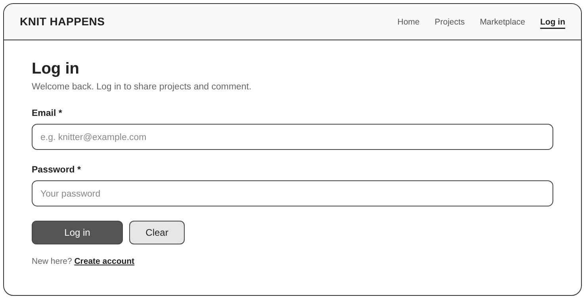
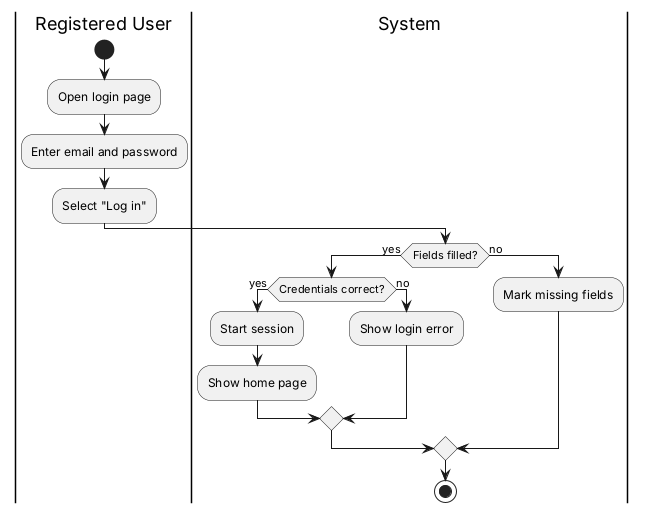

**Type:** Authentication (reads the account data, creates a session)
**Primary actor:** Registered User (a person with an account who is not yet logged in)
**Related use cases:** UC1 (creates the account), UC4 and UC5 (require a logged-in user)

### Revision History

| Version | Date | Description | Author |
|---|---|---|---|
| 1.1 | 2026-11-14 | Initial draft | Mariana |

## 1. Use-Case Name
Log in

### 1.1 Brief Description
A Registered User enters their email and password. The system checks the credentials and starts a session, so the user can use functions that require an account, such as sharing a project or commenting.

Behavior as executable scenarios: [UC2 feature file](features/uc2_log_in.feature)

## 2. Flow of Events

### 2.1 Wireframe

### 2.2 Activity Diagram

### 2.3 Basic Flow
1. The Registered user opens the login page.
2. The system shows the login form (email, password).
3. The Registered user enters the credentials and selects "Log in".
4. The system checks that all fields are filled.
5. The system checks the credentials.
6. The system starts a session.
7. The system shows the home page.
8. The use case ends.

### 2.4 Alternative Flows

**A1: A field is empty** (at step 4)
1. The system marks the missing fields.
2. The flow continues at step 3.

**A2: Credentials are wrong** (at step 5)
1. The system shows a login error. The message does not say whether the email or the password was wrong.
2. The flow continues at step 3.

**A3: User is already logged in** (at step 1)
1. The system redirects the user to the home page.
2. The use case ends.

## 3. Special Requirements
- The error message must not reveal whether an email is registered.
- Passwords are compared in hashed form, never in plain text.
- Session lifetime: *tbd*.
- Handling of repeated failed attempts: *tbd*.
- Password reset is not part of this use case (*tbd* whether it is planned).

## 4. Preconditions
- The user has an account (UC1).
- The user is not logged in.

## 5. Postconditions
- **Success:** A session exists, and the user is logged in as a Registered User.
- **Failure:** No session is created, and the user stays logged out.

## 6. Extension Points
None.
