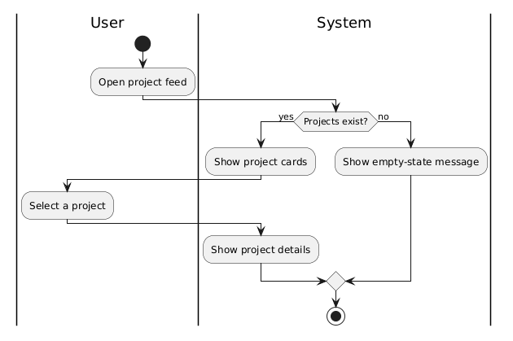

# UC3: Explore projects

**Type:** CRUD – Read (reads shared projects)
**Primary actor:** Platform User (User or Registered User)
**Related use cases:** UC4 (creates the projects shown in the feed), UC5 (starts from a project's detail page)

## 1. Use-Case Name
Explore projects

### 1.1 Brief Description
A user browses the feed of shared knitting projects to find inspiration and opens a project to see its details. No login is required.

Behavior as executable scenarios: [UC3 feature file](features/uc3_explore_projects.feature)

## 2. Flow of Events

### 2.1 Wireframe

### 2.2 Activity Diagram

### 2.3 Basic Flow
1. The user opens the project feed.
2. The system checks whether shared projects exist.
3. The system shows the projects as cards with photo, title and creator.
4. The user scrolls and selects a project.
5. The system shows the project details.
6. The use case ends.

### 2.4 Alternative Flows

**A1: No projects exist** (at step 2)
1. The system shows an empty-state message.
2. The use case ends.

**A2: Project no longer exists** (at step 5)
1. The system shows an error that the project is no longer available.
2. The system refreshes the feed.
3. The flow continues at step 3.

**A3: User wants to interact** (after step 5)
1. A user selects a function that needs an account, such as commenting.
2. The system asks the Visitor to log in or create an account.
3. The use case ends. UC2 or UC1 can be started.

## 3. Special Requirements
- The feed must load quickly and work on phone screens. Maximum load time: *tbd*.
- Sorting of the feed (for example, newest first): *tbd*.
- Number of projects loaded at once (paging): *tbd*.

## 4. Preconditions
None. A login is not required.

## 5. Postconditions
- The user has viewed projects. No data is changed.

## 6. Extension Points
None.

