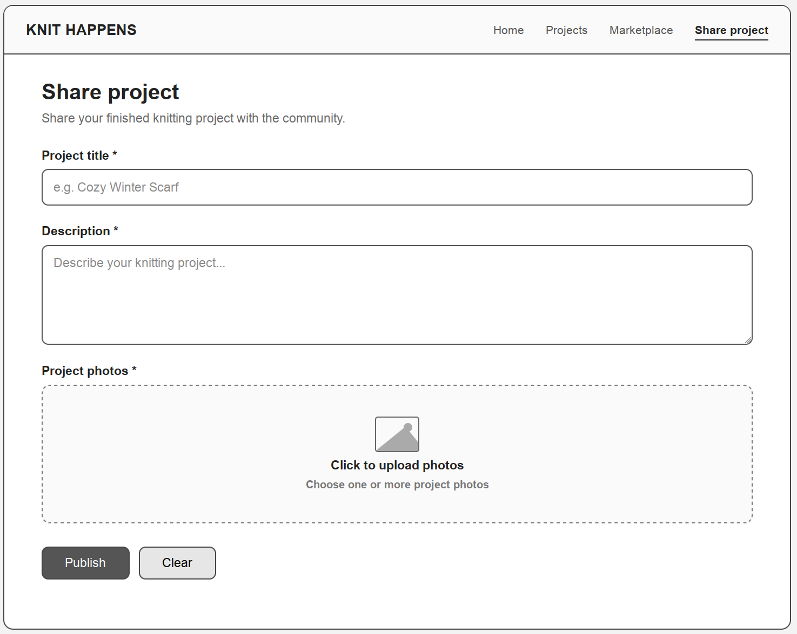
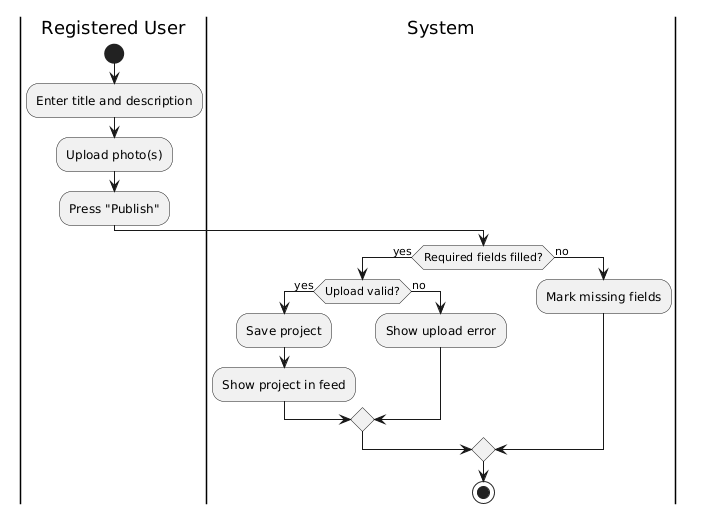

# UC4: Share project

**Type:** CRUD – Create (creates a project)
**Primary actor:** Registered User
**Related use cases:** UC2 (the user must be logged in), UC3 (shows the shared projects in the feed)

## 1. Use-Case Name
Share project

### 1.1 Brief Description
A Registered User publishes a finished knitting project with a title, a description and one or more photos. After publishing, the project appears in the feed for everyone.

Behavior as executable scenarios: [UC4 feature file](features/uc4_share_project.feature)

## 2. Flow of Events

### 2.1 Wireframe

### 2.2 Activity Diagram

### 2.3 Basic Flow
1. The user opens "Share project".
2. The system shows the form (title, description, photo upload).
3. The user enters a title and a description.
4. The user uploads one or more photos.
5. The user selects "Publish".
6. The system checks that all required fields are filled.
7. The system checks that the uploaded photos are valid.
8. The system saves the project and links it to the user.
9. The system shows the project in the feed.
10. The use case ends.

### 2.4 Alternative Flows

**A1: Required field is missing** (at step 6)
1. The system marks the missing fields.
2. The flow continues at step 3.

**A2: Photo upload is invalid** (at step 7)
1. The system shows an upload error (invalid format, file too large, or the upload failed).
2. The flow continues at step 4.

**A3: User cancels** (at any step from 2 to 5)
1. The user selects "Cancel".
2. The system discards the entered data. Nothing is saved.
3. The use case ends.

## 3. Special Requirements
- Allowed photo formats and maximum file size: *tbd*.
- Maximum number of photos per project: *tbd*.
- Users may upload only their own photos. Checking this is out of scope for this project.
- Listing materials and stores is not part of this use case (planned later).

## 4. Preconditions
- The user is logged in (UC2).

## 5. Postconditions
- **Success:** The project is saved and visible in the feed.
- **Failure or cancel:** Nothing is saved.

## 6. Extension Points
None.
