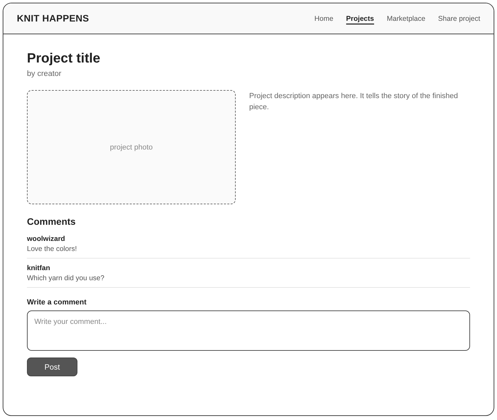
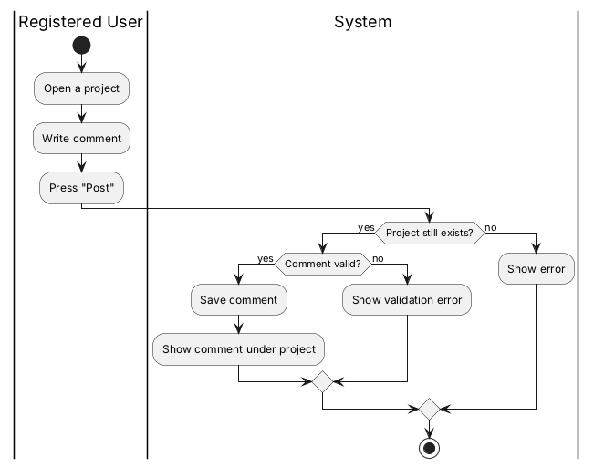

# UC5: Comment on project

**Type:** CRUD – Create (creates a comment)
**Primary actor:** Registered User
**Related use cases:** UC2 (the user must be logged in), UC3 (the user opens the project from the feed)

### Revision History

| Version | Date | Description | Author |
|---|---|---|---|
| 1.1 | 2026-10-20 | Initial draft | Mariana |
| 1.1 | 2026-11-14 | Updated raft in the new format | Mariana |

## 1. Use-Case Name
Comment on project

### 1.1 Brief Description
A Registered User writes a comment on a shared project to give feedback. After posting, the comment is visible under the project for everyone.

Behavior as executable scenarios: [UC5 feature file](features/uc5_comment_on_project.feature)

## 2. Flow of Events

### 2.1 Wireframe

### 2.2 Activity Diagram

### 2.3 Basic Flow
1. The user opens a project.
2. The system shows the project details with its existing comments and a comment field.
3. The user writes a comment and selects "Post".
4. The system checks that the project still exists.
5. The system validates the comment.
6. The system saves the comment with its author and the time.
7. The system shows the comment under the project.
8. The use case ends.

### 2.4 Alternative Flows

**A1: Comment is invalid** (at step 5)
1. The system rejects the comment (for example, it is empty or too long) and shows a validation error.
2. The flow continues at step 3.

**A2: Project was removed** (at step 4)
1. The system shows an error that the project no longer exists.
2. The use case ends.

## 3. Special Requirements
- Maximum comment length: *tbd*.
- Comments are plain text and are escaped when displayed, so they cannot inject code.
- Moderation, editing and deleting comments are out of scope for this project.

## 4. Preconditions
- The user is logged in (UC2).
- The project exists.

## 5. Postconditions
- **Success:** The comment is saved and visible under the project.
- **Failure:** No comment is saved.

## 6. Extension Points
None.
