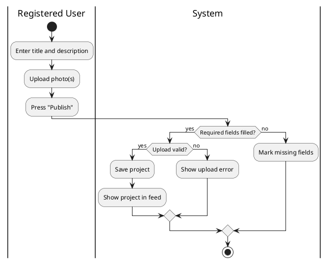
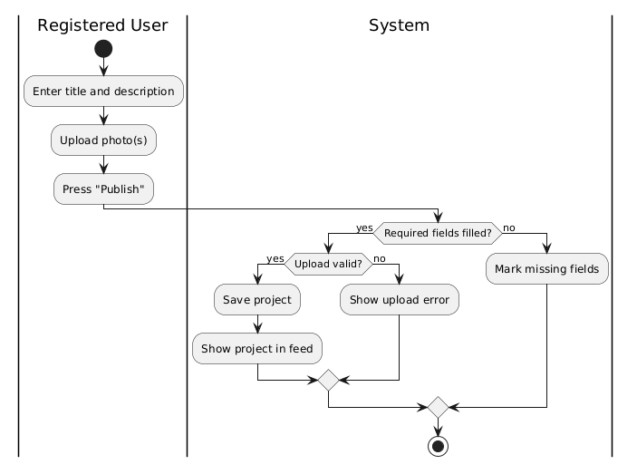
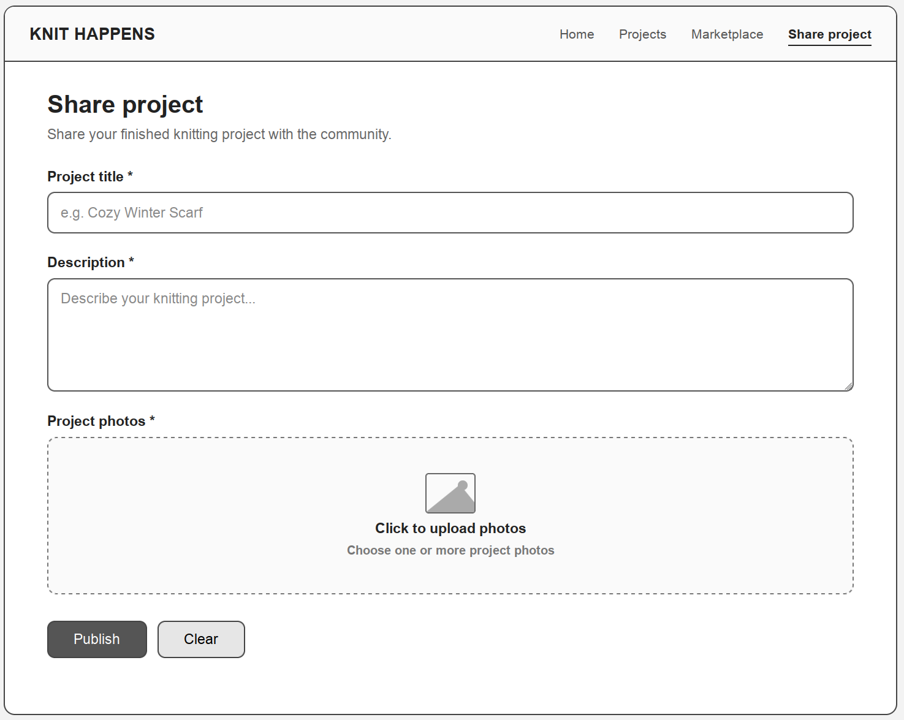

**KNIT HAPPENS**

# Use Case Specification: Share project

Version 1.0

## Revision History

| **Date** | **Version** | **Description** | **Author** |
| --- | --- | --- | --- |
| 26.10.2026 | 1.0 | Init | KNIT HAPPENS |
|  |  |  |  |
|  |  |  |  |
|  |  |  |  |

## Table of Contents

- 1. Use-Case Name
  - 1.1 Brief Description
- 2. Flow of Events
  - 2.1 Basic Flow
  - 2.2 Alternative Flows
- 3. Special Requirements
- 4. Preconditions
- 5. Postconditions
- 6. Extension Points

# Use-Case Specification: Share project

# 1. Use-Case Name

Share project

## 1.1 Brief Description

A registered user publishes a finished knitting project with photos and a description.

# 2. Flow of Events

## 2.1 Basic Flow

1. The user selects "Share project".
2. The user enters a title and a description.
3. The user uploads one or more photos.
4. The user reviews and publishes.
5. The system saves the project and shows it in the feed.

### 2.1.1 Activity Diagram

### 2.1.2 Gherkin Narrative

[Gherkin Narrative](../../src/test/UseCase_ShareProject.feature)

### 2.1.3 Mock-Up Wireframe

## 2.2 Alternative Flows

(n/a)

# 3. Special Requirements

(n/a)

# 4. Preconditions

(n/a)

# 5. Postconditions

(n/a)

# 6. Extension Points

(n/a)

