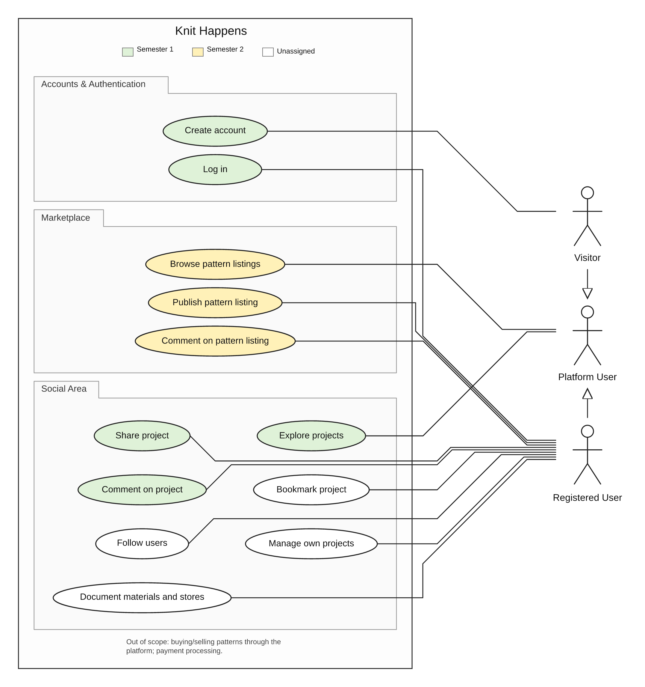
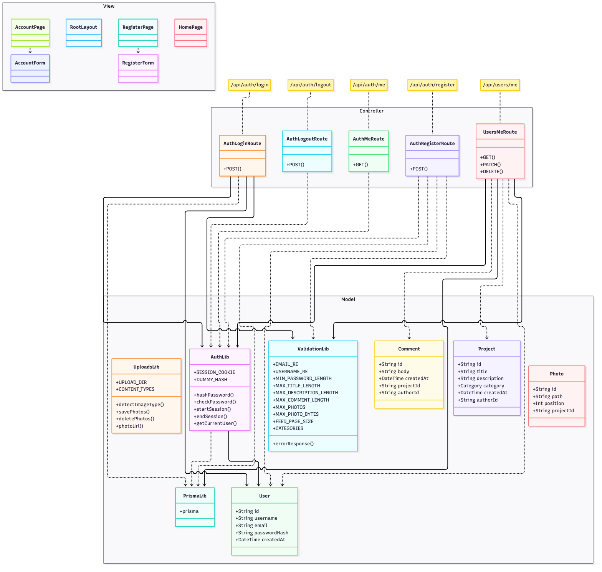
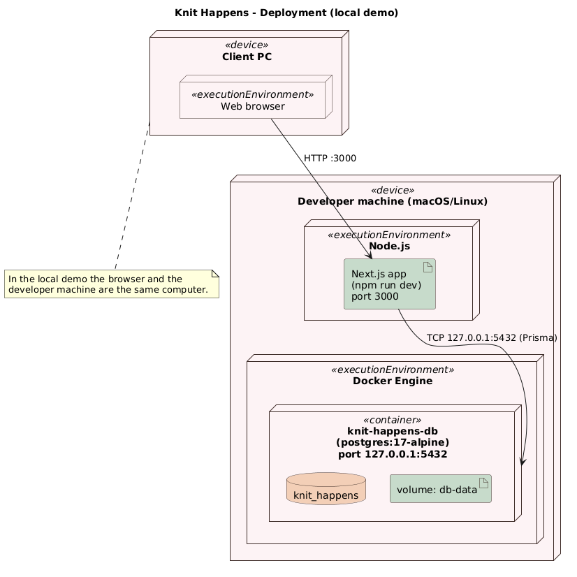
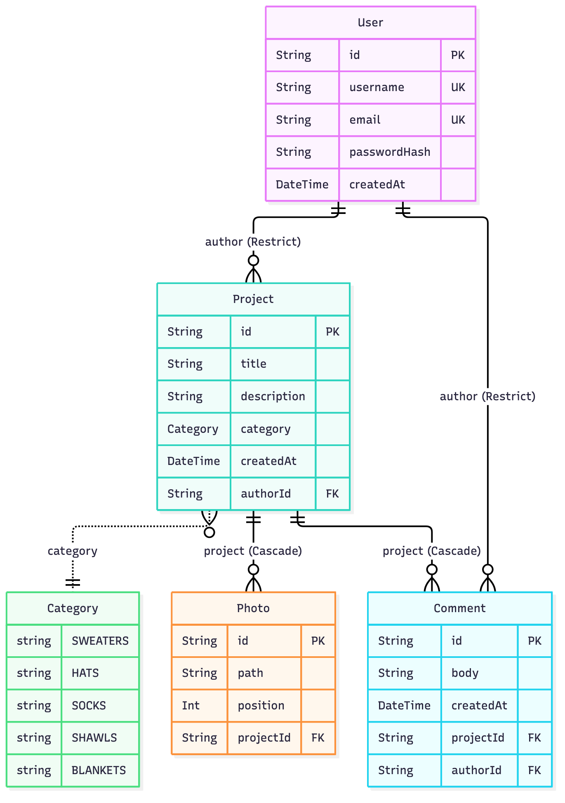

# Knit Happens — Software Architecture Document

## 1. Introduction

This document describes the software architecture of Knit Happens, a web app where knitters share projects, trade patterns and find yarn stores. It explains how the code is organised (MVC), which technologies we use and how the system is deployed.

**Scope:** the current milestone, use cases UC-01 to UC-05 (create an account, log in, explore projects, share project, comment on project). Only UC-01 (create an account) and the user account CRUD are implemented so far. The other use cases are planned and appear in the diagrams only where the code or schema already supports them.

Related documents:

- [Software Requirements Specification](../W4_UseCases/SoftwareRequirementsSpecification.md)
- [README](../../README.md) (setup and local demo)

## 2. MVC type

Knit Happens uses **server-side MVC inside the Next.js App Router**. The code runs on one Node.js server, and the browser talks to it over HTTP.

| MVC layer | Where it lives in the code |
|---|---|
| **View** | `page.js`, `layout.js` and `*Form.js` React components in `src/app/`. Pages and layouts are server components. Forms such as `RegisterForm.js` and `AccountForm.js` are client components. |
| **Controller** | Route handlers in `src/app/api/**/route.js` (for example `api/auth/register` and `api/users/me`). They read the request, validate input, call the model and return JSON. |
| **Model** | The Prisma models in `prisma/schema.prisma`, the Prisma client in `src/lib/prisma.js`, and the helper modules in `src/lib/` (`auth.js`, `validation.js`, `uploads.js`). |

**Request flow:** browser → page and form (View) → `fetch` to an API route (Controller) → Prisma (Model) → PostgreSQL → JSON response → the form updates the UI.

## 3. MVC tool / technology description

| Technology | Version | Role | MVC layer |
|---|---|---|---|
| Next.js (App Router) | 16.4.6 | Web framework: file-based routing, server rendering, route handlers | View and Controller |
| React | 19.3.0 | UI components | View |
| Prisma | 7.10.1 | ORM and database migrations | Model |
| PostgreSQL | 17 (Docker image `postgres:17-alpine`) | Relational database | Model |
| Tailwind CSS | 4.3.3 | Styling | View |
| bcryptjs | ^3.0.3 | Password hashing | Model |
| Custom signed-cookie session (`src/lib/auth.js`) | n/a (own code) | Login state: HMAC-SHA256 signed with `SESSION_SECRET`, httpOnly cookie, valid 7 days. It is **not** Auth.js. | Model (used by Controllers) |
| Docker Compose | n/a | Runs PostgreSQL the same way on every machine | Infrastructure |
| ESLint | ^9 | Code style checks (`npm run lint`) | Tooling |

**Why this framework:** Next.js gives us one JavaScript codebase for both the UI and the API, file-based routing that is easy to learn, and, together with Prisma, a database layer whose schema and migrations are tracked in version control.

## 4. Use case diagram



| ID | Use case | Document |
|---|---|---|
| UC1 | Create account | [UC1_Create_an_account.md](../W4_UseCases/UC1_Create_an_account.md) |
| UC2 | Log in | [UC2_Log_in.md](../W4_UseCases/UC2_Log_in.md) |
| UC3 | Explore projects | [UC3_Explore_projects.md](../W4_UseCases/UC3_Explore_projects.md) |
| UC4 | Share project | [UC4_Share_project.md](../W4_UseCases/UC4_Share_project.md) |
| UC5 | Comment on project | [UC5_Comment_on_project.md](../W4_UseCases/UC5_Comment_on_project.md) |

All requirements are in the [SRS](../W4_UseCases/SoftwareRequirementsSpecification.md).

## 5. Architecture diagrams

### 5.1 MVC diagram for the framework (from the web)


Source: Wikimedia Commons, "MVC-Process.svg" by RegisFrey, public domain ([file page](https://commons.wikimedia.org/wiki/File:MVC-Process.svg)).

In the generic diagram the user sends input to the controller, the controller updates the model, and the view shows the model to the user. In Next.js the "user input" is an HTTP request or a form submit, the **controller** is a route handler, the **model** is Prisma plus PostgreSQL, and the **view** is the React page that renders the result.

### 5.2 Class diagram with MVC regions



The `Model`, `View` and `Controller` namespaces in the diagram are the MVC regions. Arrows are imports between modules. The diagram is auto-generated by `npm run docs:classes` (script `scripts/class-diagram.mjs`). The Mermaid source is in [class-diagram.md](class-diagram.md).

## 6. Automated deployment

**Status: planned for semester 2. It does not exist yet.** The demo currently runs locally, as described in the [README](../../README.md).

The plan is:

- a Dockerfile for the Next.js app
- GitHub Actions CI (lint, build, `prisma migrate deploy`) and CD to a Linux server running Docker
- the same `postgres:17-alpine` image as local development

## 7. Deployment diagram (UML)



The diagram shows the **local demo setup**. The browser reaches the Next.js app on port 3000, and the app reaches PostgreSQL in a Docker container on `127.0.0.1:5432`. The data lives in the Docker volume `db-data`. The production deployment diagram will be added in semester 2.

Source: [deployment.puml](deployment.puml). Render it locally (nothing is sent to a public server) from the repository root:

```bash
docker run --rm -v "$PWD/docs/architecture:/data" plantuml/plantuml -tpng /data/deployment.puml
```

## 8. EER model



The diagram is auto-generated from `prisma/schema.prisma` by `npm run docs:erd`. The Mermaid source is in [erd.md](erd.md).

- **User** has many Projects and many Comments. `username` and `email` are unique, and the password is stored only as `passwordHash`.
- **Project** belongs to one User (author) and has a `Category` (SWEATERS, HATS, SOCKS, SHAWLS, BLANKETS). It has many Photos and many Comments.
- **Photo** belongs to one Project and stores only a file path and a display `position`.
- **Comment** belongs to one Project and one User (author).
- Deleting a User who still has Projects or Comments is blocked (`onDelete: Restrict` on both author relations).
- Deleting a Project also deletes its Photos and Comments (`onDelete: Cascade`).
